# HR Data Portal

**Plataforma web interna que automatiza la carga y limpieza mensual de reportes de nómina y headcount, y deja los datos listos para Power BI.**

> Este repositorio es una **vista de portafolio**: describe el problema, la solución y el resultado, con capturas. **No incluye código** (el proyecto original maneja datos de una organización y su repositorio es privado).
> Todas las imágenes usan **datos y empresas inventados**.

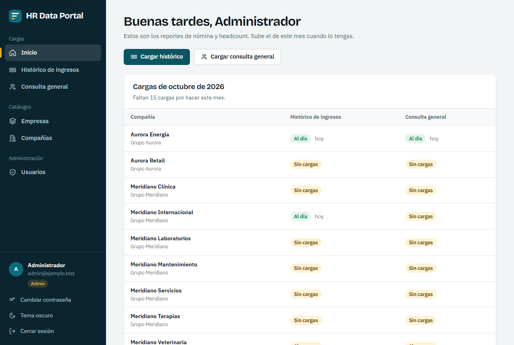

---

## El problema

Cada mes, varias empresas de un mismo grupo descargaban dos reportes en Excel de su sistema de nómina:

* **Histórico de ingresos**: pagos de nómina por empleado y periodo.
* **Consulta general (headcount)**: la "foto" del estado de cada empleado (activo, retirado, antigüedad…).

Esos archivos se **limpiaban a mano en Power Query** antes de llegar al dashboard. Era un trabajo repetitivo y frágil: una fecha con el día y el mes invertidos, una columna que cambió de lugar,
un archivo cargado dos veces… y nadie sabía a simple vista **qué compañías ya tenían su mes cargado**.

## La solución

Un portal donde la persona **sube el Excel tal cual lo descarga**, el sistema aplica las reglas de limpieza, **le muestra cómo quedaron los datos** y solo al confirmar los guarda en la base de datos.
Power BI lee esos datos limpios a través de una API protegida.

### Qué hace

* **Lee los archivos por nombre de columna, no por posición**, con un diccionario de variantes de encabezado: cada persona exporta con un orden distinto y el sistema lo tolera.
* **Aplica las reglas de negocio** de cada reporte: código único por empresa, clasificación de horas extras, quincena de nómina, estado real de salida, antigüedad, fechas sin ambigüedad.
* **Revisión antes de guardar**: resumen en cifras, tabla paginada, filas con problemas resaltadas. Nada se guarda hasta confirmar.
* **Carga idempotente**: subir dos veces el mismo mes **reemplaza**, no duplica, y el portal **avisa antes** (y exige confirmación) cuando va a reemplazar datos existentes.
* **Vista "Cargas del mes"**: por compañía y por reporte, qué está al día y qué falta.
* **Historial y auditoría**: quién cargó qué, cuándo y cuántas filas; los administradores pueden eliminar una carga equivocada.
* **API para Power BI** con clave, paginada, con fechas en formato ISO listas para el modelo.
* **Gestión de usuarios y catálogos** (empresas y compañías) para administradores.
* **Modo oscuro y uso desde el celular.**

## Cómo se usa

Una carga tiene tres pasos: **elegir archivo → revisar → confirmar**.

| 1. Elegir archivo | 2. Revisar | 3. Confirmado |
|---|---|---|
| 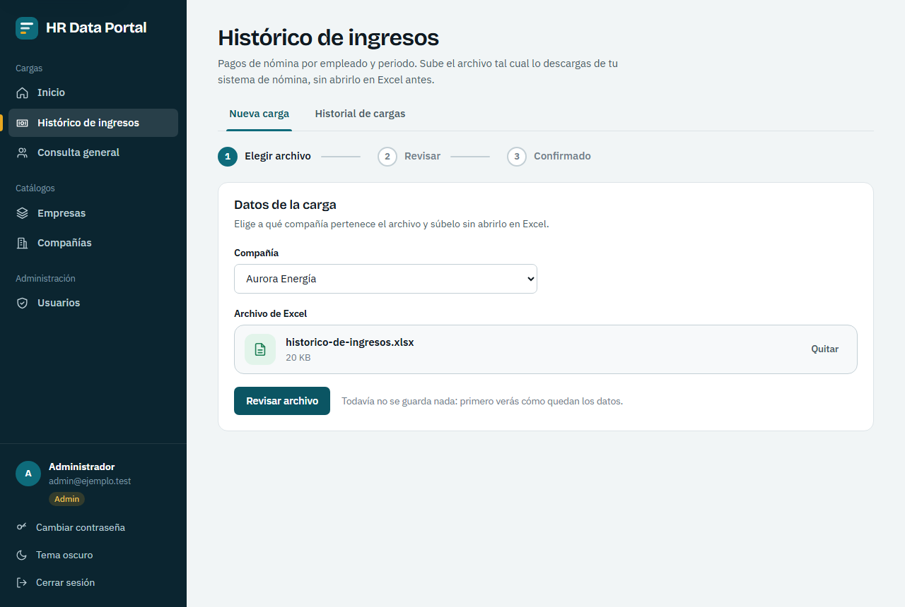 | 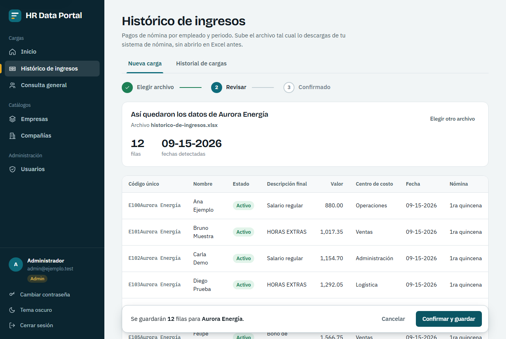 | 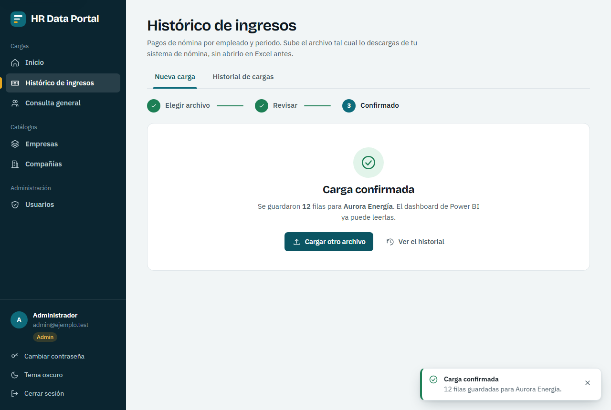 |

Si el mes ya estaba cargado, el portal lo dice con claridad y pide confirmar el reemplazo:

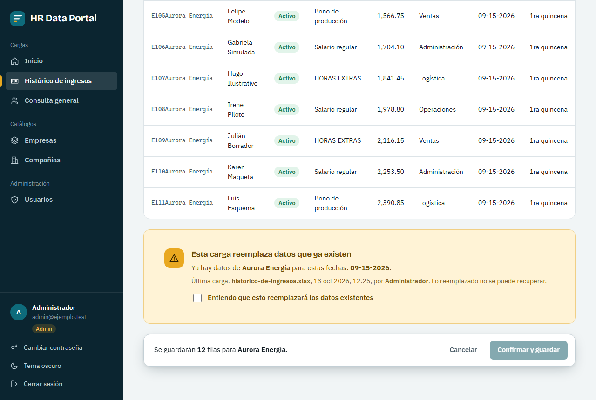

Si el archivo no corresponde al reporte, explica qué faltó y qué columnas encontró, para que la persona se autodiagnostique:

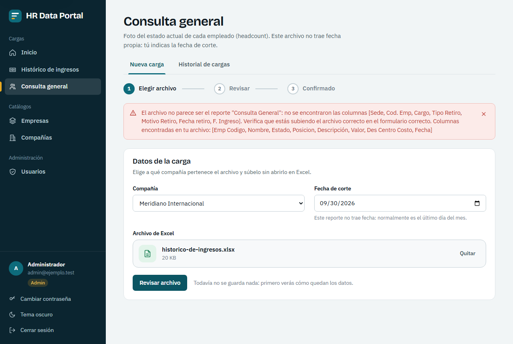

La **Consulta general** funciona igual, con un dato más (la fecha de corte, porque ese reporte no trae fecha) y resalta las salidas del mes:

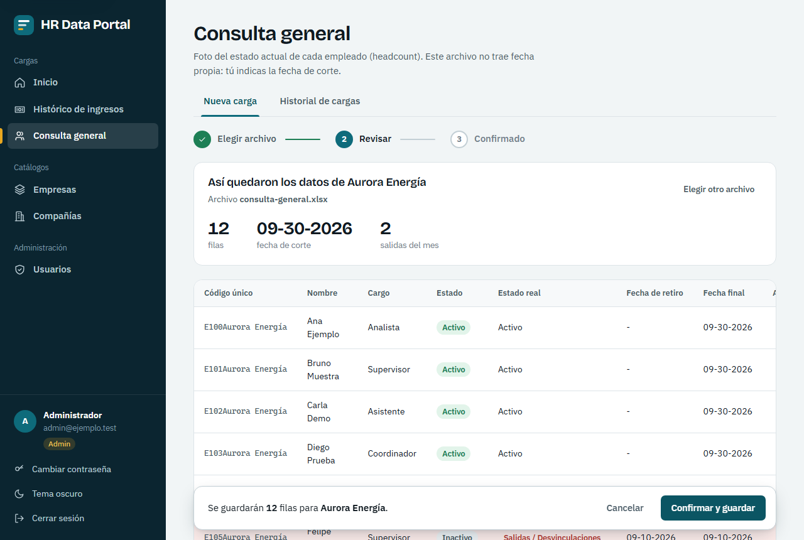

## Más capturas

| Inicio de sesión | Crear contraseña | Historial de cargas |
|---|---|---|
| 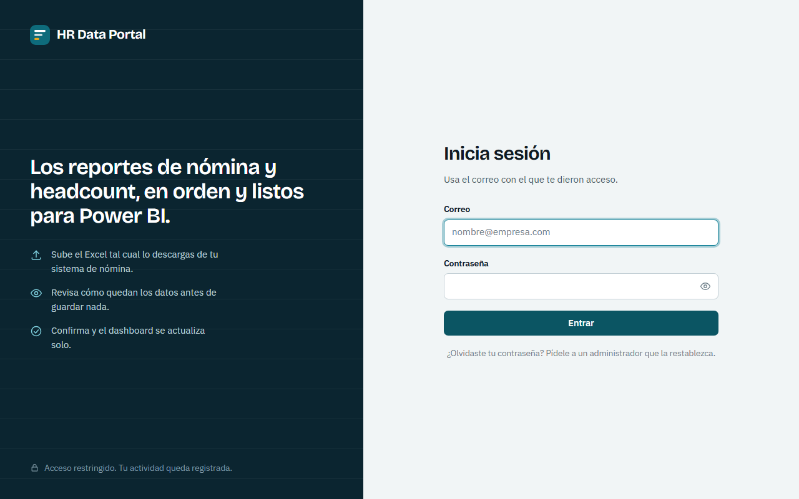 | 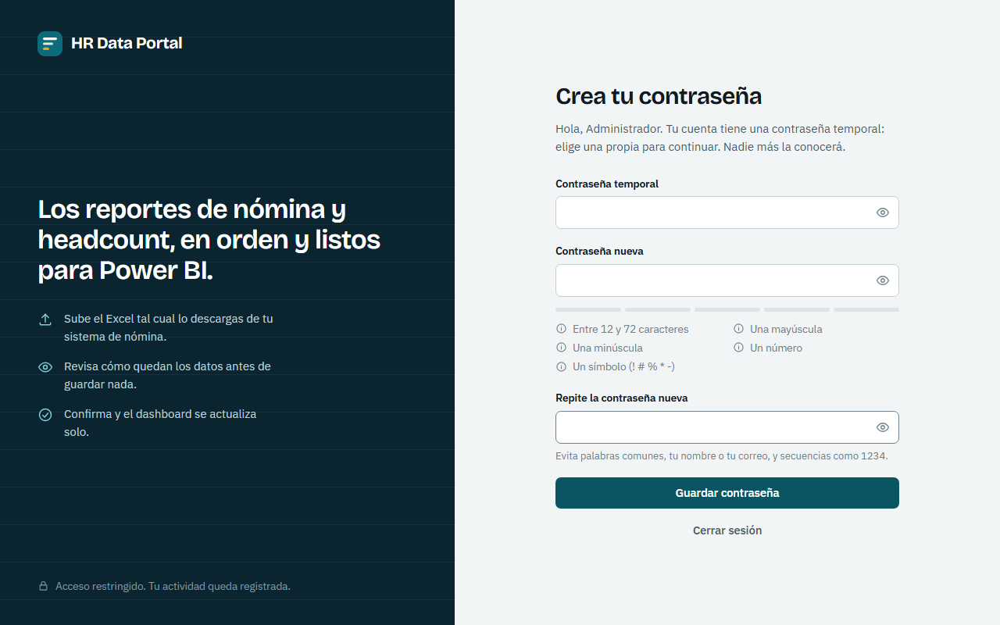 | 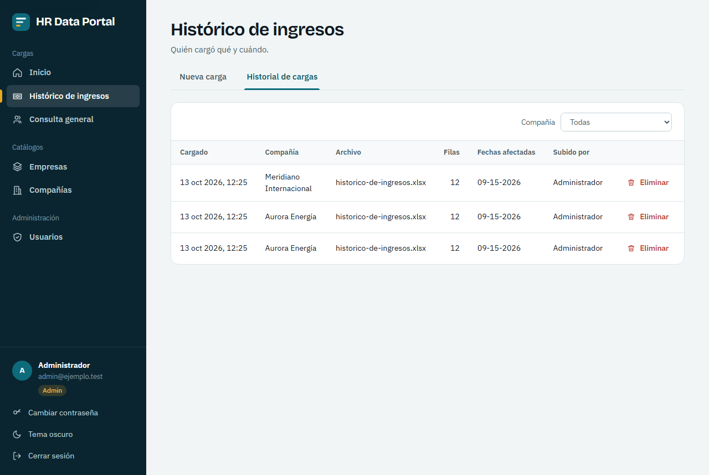 |

| Usuarios | Contraseña temporal (se muestra una sola vez) | Tema oscuro |
|---|---|---|
| 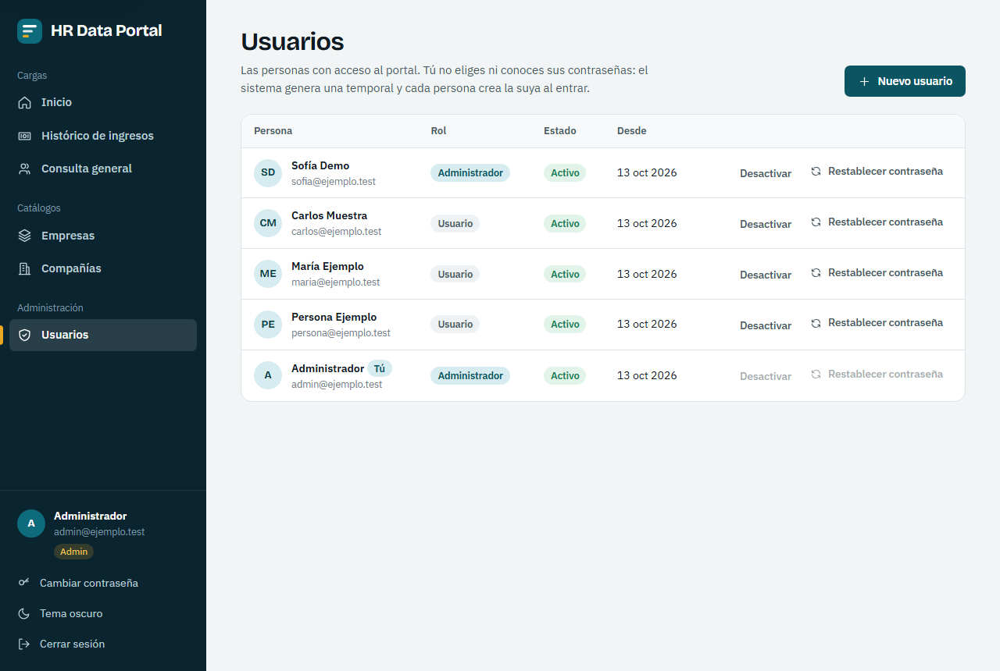 | 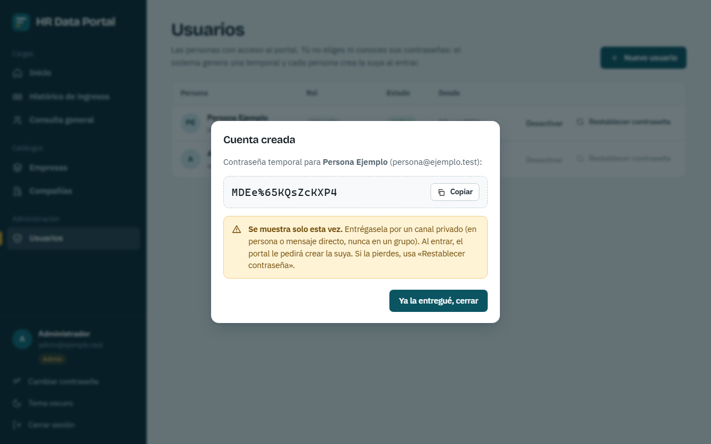 | 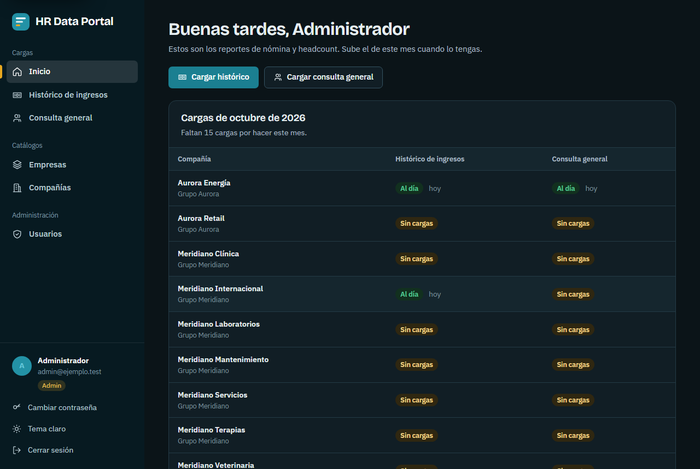 |

| En el celular: inicio | En el celular: carga |
|---|---|
| 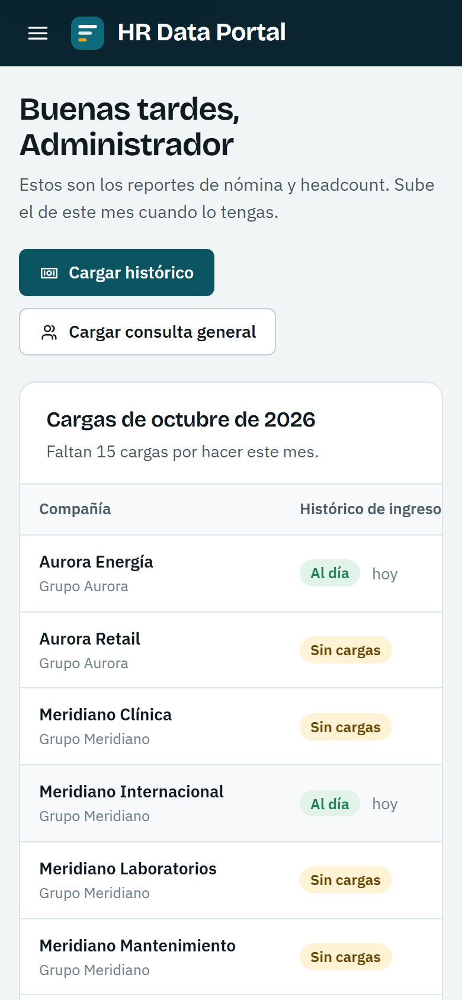 | 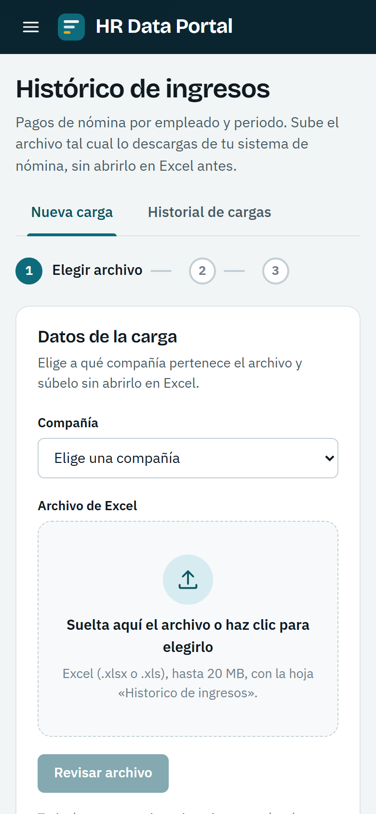 |

## Cómo está construido

```
 Navegador (aplicación web)            Power BI
        │  HTTPS                          │  HTTPS + clave
        ▼                                 ▼
   Servidor web (proxy inverso, certificado)
        │
        ▼
   Un solo proceso Node (API REST + aplicación web)  ← administrado con PM2
        │
        ▼
   Base de datos MySQL
```

| Capa | Tecnología |
|---|---|
| Interfaz | React, TypeScript, Vite; sistema de diseño propio (sin librerías de componentes), tipografías autoalojadas |
| API | Node.js, Express, TypeScript, validación de entradas con Zod |
| Datos | MySQL, Prisma |
| Lectura de Excel | SheetJS |
| Pruebas | Vitest, Supertest, Puppeteer |
| Despliegue | Servidor Linux, nginx, PM2 |

### Decisiones que vale la pena contar

* **Lo que se guarda lo calcula el servidor, no el navegador.** La previsualización queda en memoria del servidor y la confirmación solo referencia ese resultado: el cliente no puede alterar cifras entre revisar y confirmar.
* **Un único flujo de carga compartido** por los dos reportes, con revisión paginada (antes se pintaban todas las filas, aunque fueran miles).
* **Diseñado para una rutina mensual**: lo memorable no es decoración, es la vista que responde "¿qué me falta cargar?".
* **Cambios sin tocar la base de datos**: pensando en un servidor compartido, las mejoras de seguridad y de experiencia se diseñaron para no exigir cambios de estructura.

## Seguridad

La seguridad se diseñó desde el principio, no como parche final:

* **Sesiones revocables**: una cuenta desactivada o degradada pierde el acceso al instante; cambiar la contraseña cierra las sesiones de otros dispositivos.
* **Contraseñas generadas por el sistema**: ni el administrador conoce ni elige la contraseña de nadie; la temporal se muestra una sola vez y la persona crea la suya al entrar. Política exigente y verificación contra filtraciones conocidas (sin enviar la contraseña).
* **Protección contra fuerza bruta** con bloqueo progresivo, límites por persona en las operaciones costosas y bitácora de accesos (sin guardar contraseñas).
* **Autorización siempre en el servidor** (lo que la interfaz oculta no es seguridad), validación de todas las entradas y de los archivos por su contenido real.
* **Navegador**: política de seguridad de contenido estricta, cabeceras de seguridad y cero recursos de terceros.
* **Dependencias auditadas** y respaldos programados de la base de datos.

## Calidad

* **133 pruebas automáticas**, incluidas 29 que ejercitan la aplicación real contra una base de datos real (ataques de sesión, límites, permisos, archivos inválidos, cabeceras).
* **Recorrido completo en un navegador real** (16 comprobaciones) con las mismas cabeceras de seguridad de producción.
* Documentación técnica (para poder rehacer el proyecto desde cero), guía de usuario con capturas y un documento de entrega para despliegue, con verificación posterior y plan de reversión.

---

## Contacto

* **LinkedIn**: [linkedin.com/in/jordandiax](https://www.linkedin.com/in/jordandiax/)
* **GitHub**: [github.com/JordanDiaz07](https://github.com/JordanDiaz07)
* **Teléfono**: +507 63965192
